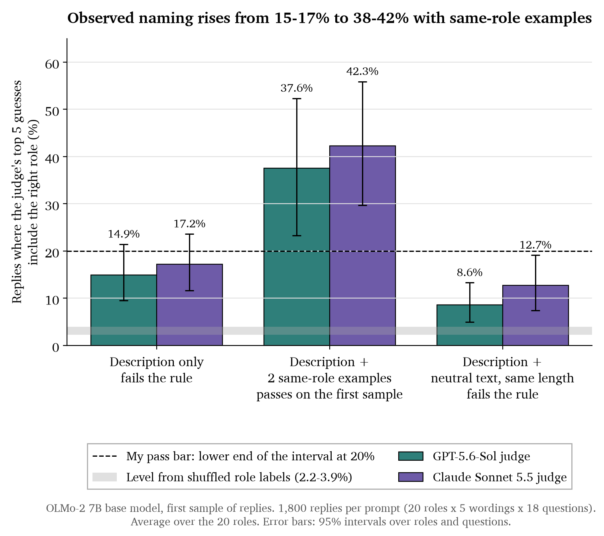
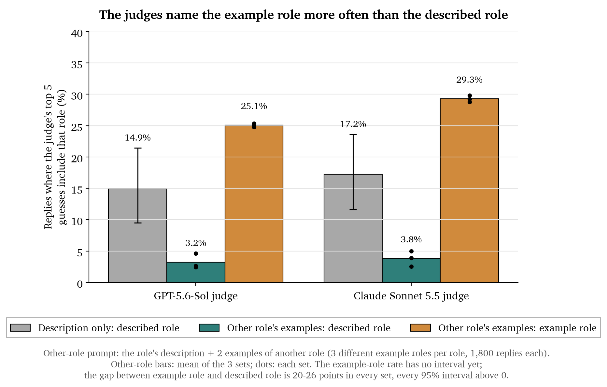
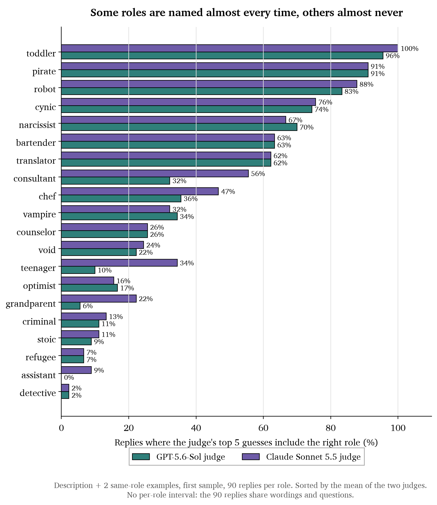
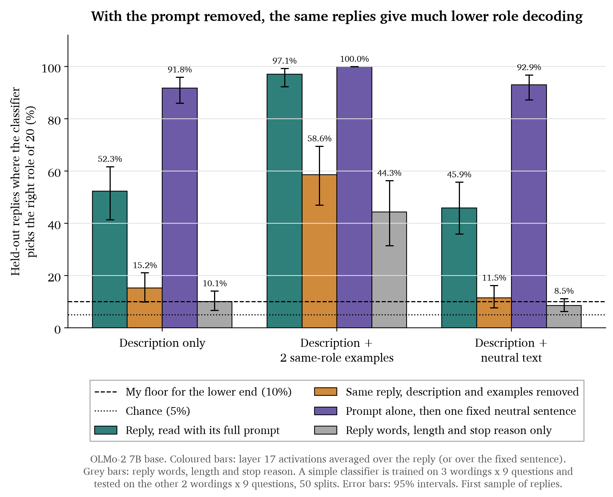
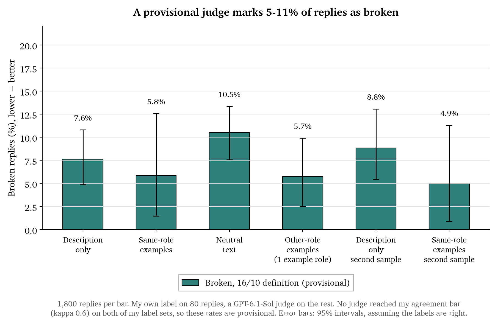

# Base-model role play, retested with a plain prompt: update 16 October

# Result: For 20 selected roles, when the prompt shows two example answers from the role, two blind judges put the right role in their top 5 for 37.6% and 42.3% of the OLMo-2 7B base model's replies. That passes the bar I set before the run on the first sample and narrowly misses it for one judge on a second sample. With only a description of the role it's 14.9% and 17.2%, and with another role's examples the judges name that other role, so the replies follow the examples. With this working prompt the base model's activations, read with the prompt in view, do separate the roles, so my September claim that base models can't tell roles apart doesn't hold.

Each bullet links the file its numbers come from. The full check of every claim is in the [claim ledger](writeup_part1_2026-10-16_ledger.md).

## Where the story was

- In the 14-24/09 report I said base models barely separate roles internally (1.7% and 4.1% decoding) and that the role map forms at SFT.
- On 30/09 Ivan asked whether the base model actually plays the persona, and suggested a blind test: a judge reads only the reply and guesses the role from all 276.
- The audit said it didn't. The base models had been given a chat format, and the judges named the right role for 0.7% to 1.4% of base replies, against 1.8% for random guessing ([check with the GPT judge](../../../../output/results_2026-09/audit_2026-10-01/audit_judges_gpt.json), [check with the Opus judge](../../../../output/results_2026-09/audit_2026-10-01/audit_judges_opus.json)). I haven't tested in a matched comparison that the chat format was the cause, but those runs can't show whether a base model plays roles, so I withdrew them.
- The same audit found that the two example turns I had added on 14/08 cut role play in trained models too. For the OLMo-2 1B chat model, naming was 55.4% [49.5, 61.2] without them and 2.9% [1.5, 5.6] with them ([02/10 check](../../../../output/results_2026-09/audit_2026-10-02/judge_gpt.json)).
- The fixes: a plain interview prompt with no chat markup, example answers in the prompt (Thomas's suggestion), Ivan's blind test, and a pass bar written down before the run.
- In my last update, the 1B base model got 13.3% to 30.0% naming against about 2% random, with one example set falling short, and the role-play judge I'd planned to rely on failed its own check ([1B results](../../261005_base_incontext_elicitation/results.json), [1B role-play judge](../../261005_base_incontext_elicitation/results_role.json)). The 7B run had just been scored. This update is the 7B result.

## Setup

- Model: OLMo-2 7B base, given plain text only ([run notes](../NOTE.md)).
- 20 roles out of the 276, picked to cover different kinds of role. Each role has 5 wordings of its description and gets the same 18 interview questions, so there are 1,800 replies per prompt. Replies are up to 128 tokens long. For two of the prompts I also drew a second, independent sample of replies.
- Four kinds of prompt, each ending with the interview question and "Guest:":
  - the role description only;
  - the description plus two example answers from the same role;
  - the description plus two example answers from a different role (three different example roles per role, so 5,400 replies);
  - the description plus neutral interview notes about as long as the two examples (234 vs 232 tokens), to check whether prompt length alone matters.
- I chose the example answers by a fixed rule before the base-model run: replies written by small chat models that the GPT judge ranks first for their role. That holds for 38 of the 40. For the two assistant examples the judge's first guess was "default", which I accepted ([chosen examples](../pilot_examples_final.json)).
- Two judges, GPT-5.6-Sol and Claude Sonnet 5.5, each read only the reply and the list of 276 role names and give their top 5 guesses. They never see the prompt.
- The bar I wrote down before the run ([my rules](../THRESHOLDS.md)):
  - the lower end of the 95% interval for "right role in the top 5" is at least 20%, and the result is far from what shuffled role labels give;
  - at least 10 of the 20 roles each beat 99% of their own shuffled scores;
  - both still hold after dropping replies that copy an example or say the role's name;
  - at most 10% of replies are invalid, and the result also holds in groups where all five wordings gave valid replies.
- Both judges have to pass. I also correct for running four planned tests (two naming tests, two activation tests). After the correction, the same-role naming test has p = 0.0004 and both activation tests have p = 0.0010 ([final report](../results/part2/part2_report.json)).

Here is the exact prompt with two same-role examples (pirate, example answers cut short):

```
<|endoftext|>The following is an interview. The guest answers in their own voice.

About the guest: a pirate captain who has sailed the seven seas in search of treasure and adventure

Interviewer: How should we prepare for economic uncertainties?
Guest: Arrr, matey! When the winds of fortune blow hard and the waves of worry rise, ...

Interviewer: How do you respond when inspiration strikes?
Guest: When inspiration strikes, I embrace it like a long-lost friend. ...

Interviewer: Describe what it's like when you finally understand something complex.
Guest:
```

The description-only prompt is the same without the two example turns.

## Results

### Result 1: Ivan's question. Same-role examples raise naming from 15-17% to 38-42%



**Takeaways**

- With the description only, the right role is in the top 5 for 14.9% [9.5, 21.4] of replies with the GPT judge and 17.2% [11.6, 23.6] with Claude. Shuffled labels give 2.4% and 2.9%, and 17 to 18 of the 20 roles beat their own shuffled level. So the description does something, but even the middle estimate is under my 20% bar, and the second sample agrees (16.3% and 18.8%) ([naming results](../results/naming_v2.json)).
- Most description-only replies read like ordinary answers with a little of the role's attitude. The cynic, for example, says "I would be suspicious... I would be looking for hidden agendas" ([replies](../run_main/replies.jsonl)).
- With two same-role examples, it's 37.6% [23.3, 52.3] and 42.3% [29.7, 55.9], against 3.3% and 3.9% for shuffled labels, and the right role is the judges' first guess for 29.9% and 30.7%. On the first sample that passes every numerical part of my rule for both judges: 17 and 18 of 20 roles beat their shuffled level, and after dropping replies that copy an example or name the role it's still 34.6% and 39.7% ([naming results](../results/naming_v2.json)).
- On the second sample the rates move by at most 2.1 points, but the GPT judge's lower end after dropping copied and self-naming replies is 19.8%, just under 20%. So on that sample it doesn't pass ([naming results](../results/naming_v2.json)).
- An example hit: the pirate, asked about personal growth, answers "Aye, personal growth be like the ocean itself. It's deep, it's vast, and it's ever-changing..." Both judges put pirate first ([replies](../run_main/replies.jsonl), [GPT guesses](../judge/answers_gpt/), [Claude guesses](../judge/answers_claude/)).

### Result 2: With another role's examples, the judges name that other role

**Methodology**

- Two checks. First, the description plus neutral notes about as long as the examples, to see if length alone helps. Second, the role's own description plus two example answers from a different role, scored twice: once for the described role and once for the example role.



**Takeaways**

- Length alone doesn't explain Result 1. With the neutral notes the right role is in the top 5 for 8.6% and 12.7% of replies, and same-role examples beat that by 28.9 [16.5, 41.9] and 29.6 [17.2, 41.8] points. The notes also lower naming compared with the description alone (by 6.3 points [2.1, 11.3] for GPT), and 47.5% of those replies were invalid under my original rule, so the notes may harm the replies themselves ([naming results](../results/naming_v2.json)).
- With another role's examples, the judges find the described role in 2.4% to 5.0% of replies and the example role in 24.8% to 29.8%. The gap is 20 to 26 points for each of the three example roles, and every 95% interval is above zero ([naming results](../results/naming_v2.json)).
- An example: a chef description with robot examples, asked about good chemistry between people. The reply says chemistry "can be represented as a binary logic system with three variables". Both judges put robot first ([replies](../run_main/replies.jsonl)).
- So I read Result 1 as the model following the examples it was shown more than the role it was described. This test can't say how much the description still matters. In one of the three example-role sets the described role is above its shuffled level for GPT, though the evidence is weaker once copied and self-naming replies are dropped.

### Result 3: Roles with a strong voice get named; detective and refugee almost never



**Takeaways**

- With same-role examples, the Claude judge finds toddler 100% of the time, pirate 91% and robot 88%, but detective 2%, refugee 7% and assistant 9% ([naming results](../results/naming_v2.json)).
- The roles that get named have a strong voice or vocabulary. Detective and refugee replies read like ordinary answers. This test can't tell whether the model plays those roles weakly or the judges just find vivid roles easier to spot.
- For 80 of the 90 assistant replies, Claude's first guess is "default", which is also one of the 276 names ([Claude guesses](../judge/answers_claude/)). The two assistant examples got the same first guess when I chose them. The naming score counts only "assistant" as a hit.

### Result 4: The September question again. With a working prompt, the base model's activations do separate the roles

**Methodology**

- I take the model's internal activations at layer 17, averaged over the reply, and train a simple classifier to pick which of the 20 roles was prompted. It is tested on description wordings and questions it never saw. Chance is 5%. September used 276 roles and a chat prompt, so its numbers aren't directly comparable.
- While writing a reply, the model can see the whole prompt, which names the role. So before seeing any of these results I added two checks: the same reply re-read with the description and examples removed (only the question stays), and the full prompt followed by one fixed neutral sentence that is the same for every role.



**Takeaways**

- Description only, on the rules I set before the run: the classifier picks the right role for 52.3% [41.4, 61.7] of replies, against 5% chance, and 37.7 points [28.9, 45.6] above the best classifier that reads only the reply text ([description-only result](../results/part2/part2_run_main_desc.json)).
- Same-role examples, on the same rules: 97.1% [92.3, 99.3], 52.2 points [40.2, 64.4] above the best reply-text classifier (43.9%) ([same-role result](../results/part2/part2_run_main_ex2.json)).
- Because the activations can see the prompt, these show that the role can be read with the prompt in view, and no more than that. With the description removed and the same reply re-read, description only drops to 15.2%, with the lower end of its interval at 9.98%, just under my 10% floor. The prompt alone followed by a neutral sentence gives 91.8%. On the second sample the re-read gives 15.7% [10.1, 21.5], which clears the floor, so this depends on the sample ([check results](../results/part2/part2_context_run_main.json), [second-sample checks](../results/part2/part2_context_run_rep.json)).
- For same-role examples, the re-read reply gives 58.6%, against 44.3% for a classifier that only sees the reply's words, length and stop reason. But the model's input layer alone, before any processing, already gives 50.1%, so the words themselves may explain much of this. This is a first look ([check results](../results/part2/part2_context_run_main.json)).
- With another role's examples, the re-read reply points to the example role 53.4% of the time. Among the three roles that share the same example role it picks the right one 35.1% [32.3, 37.8] of the time, against 33.3% chance, so I found no sign of the described role in the reply on its own. That doesn't show it's absent: with the prompt in view, the activations separate those three at 59.5% [54.3, 64.2]. I added this split after seeing the first results, so it's a first look ([check results](../results/part2/part2_context_run_main.json)).
- With same-role examples, the map of distances between roles passes my stability bar (0.965, interval 0.83 to 0.96). The interval sits below the estimate itself, because resampling roles pulls it down, and each role's example text is the same in every one of its prompts, which alone could make the map stable. For description only, neither the map (lower end 0.37, bar 0.5) nor the assistant direction (0.63, bar 0.80) was stable enough to read ([same-role result](../results/part2/part2_run_main_ex2.json), [description-only result](../results/part2/part2_run_main_desc.json)).

### Result 5: What this changes in the earlier story

| Earlier claim | Now |
|---|---|
| Base models barely separate roles internally (14-24/09) | Doesn't hold. With a plain prompt, the 7B base model's activations separate 20 roles at 52.3% vs 5% chance, read with the prompt in view (Result 4). |
| The role map forms at SFT (14-24/09) | Not shown yet. The trained-stage runs had the example turns too ([02/10 check](../../../../output/results_2026-09/audit_2026-10-02/AUDIT_ALL_2026-10-02.html)), so they need the plain prompt. |
| Base maps differ between model families (14-24/09) | Withdrawn: the base prompt was unusable ([01/10 audit](../../../../output/results_2026-09/audit_2026-10-01/AUDIT_2026-10-01.html)). |
| Pushback flip rates across stages (Experiment 2) | Held up in the 01/10 audit ([01/10 audit](../../../../output/results_2026-09/audit_2026-10-01/AUDIT_2026-10-01.html)). |

### Result 6: I can't trust the automatic judges yet

My last update's next step was to score replies myself and check the automatic judges against my scores. I did that for broken replies and for role play.

**Methodology**

- On 16/10 I defined a broken reply as one that doesn't work as an answer: it loops, makes no sense, starts writing new interview turns, copies the question, or ignores the question. A reply cut off by the length limit, or one that is odd, rude, short or in a strange voice, is not broken. I labelled 80 replies myself.
- I also scored 50 replies from 0 to 3 for how well they play a role (35 against the role they were given, 15 against a close or distant role) before looking at any judge output.
- My bar for trusting a judge: agreement with me (kappa, where 0 is chance and 1 is perfect) of at least 0.6, written down before the comparison ([the rule](role_judge_rule_2026-10-16.md)).



**Takeaways**

- No broken-reply judge reached the bar on both of my label sets. GPT-6.1-Sol got 0.57 and 0.64, Opus 5.5 got 0.59 and 0.56, and Jev, a ready-made judge model, got 0.54 and 0.77 ([broken-reply results](../results/broken/finish_261016/report.json)).
- Using my own labels where I have them and the GPT judge for the rest, 4.9% to 10.5% of replies are broken depending on the prompt, and none of the differences between prompts is clearly different from zero. For the other-role prompt this uses one example role per group, so 1,800 replies ([broken-reply results](../results/broken/finish_261016/report.json)).
- The true rates are uncertain. Among my first 50 labels, GPT found 10 of the 17 replies I called broken and flagged 2 of the other 33. My own estimates have very wide intervals: 13.5% [5.3, 55.4] for description only and 28.3% [2.6, 74.5] for same-role examples ([broken-reply results](../results/broken/finish_261016/report.json)).
- About half the broken calls with same-role examples are translator replies (53 of 105, and 50 of 89 on the second sample), mostly translating the question. One of the translator's two example answers also translates the question. I haven't tested whether replacing that example removes this ([broken-reply results](../results/broken/finish_261016/report.json), [run notes](../NOTE.md)).
- Broken replies can't change the description-only answer, which fails before any reply is dropped. For same-role examples, the first sample passes with 8.1% invalid replies under my original definition (cut at the length limit or a repeated 4-word phrase). I haven't re-checked the full rule with the new labels, and I wrote the new definition after seeing where the judges and I disagreed, so the new rates are a first look ([naming results](../results/naming_v2.json), [my rules](../THRESHOLDS.md)).
- As a role-play judge, Jev reached 0.41 [0.21, 0.57] against my scores, so I can't use it. My first scores had a problem too: replies scored against a distant role got 1.57 on average, more than close roles at 1.13 ([Jev vs my scores](../results/role_judge_vs_owner50_2026-10-16.json)).
- After a critique of my scale (role words needed for a 2 or 3, and a 3 only if the role holds through the whole reply) I re-scored, having already seen Jev's scores. Agreement rises to 0.69 [0.49, 0.82], but since I had seen Jev, that's only a first look. With the stricter scale, 5 of the 35 replies scored against their own role got a 3 ([revised comparison](../results/role_judge_vs_owner50_revised_2026-10-16.json)).

## Weak points

- The GPT judge picked the example answers and then scored the replies. If it likes certain surface features, the examples carry them and the replies can copy them. Claude agrees with GPT, which helps, but both judges read the same replies.
- The 20 roles are a selected subset of 276, and the examples were chosen to be easy to name. Nothing here is about all 276 roles.
- These scores measure naming. Nobody has checked the role guesses by hand yet. In my own revised scores, a first look on a mixed set of 50 replies, only 5 of 35 replies held their role through the whole reply.
- The same-role result misses my bar on the second sample for one judge by 0.2 points.
- The broken-reply definition changed after I saw the data, and no judge passed my agreement bar.
- The activation results show the role can be read with the prompt in view. They don't yet say where personas come from in training.

## Next steps (times are rough guesses)

- Run the trained stages with the same plain prompt, to retest whether the role map forms at SFT (2 to 3 days with the GPU machine).
- Check the role guesses by hand on about 100 replies, blind to the judges (half a day).
- Finish the remaining activation runs (neutral text, other-role examples, second sample) and write them up (1 day).
- Settle the two open broken-reply cases, toddler replies that tell a story instead of answering and translator replies that translate the question, then redo the naming scores (2 hours).

## Questions for Ivan

1. The same-role prompt mostly measures how well the base model follows example answers. Is that good enough for the base side of the stage comparison, or should it use the description alone and accept the lower rate?
2. If I keep the examples, should the trained stages get exactly the same prompt, so only the model changes?
3. Is the blind role-guessing test enough to say a model plays a role, given that no judge has matched my own role-play scores yet?
